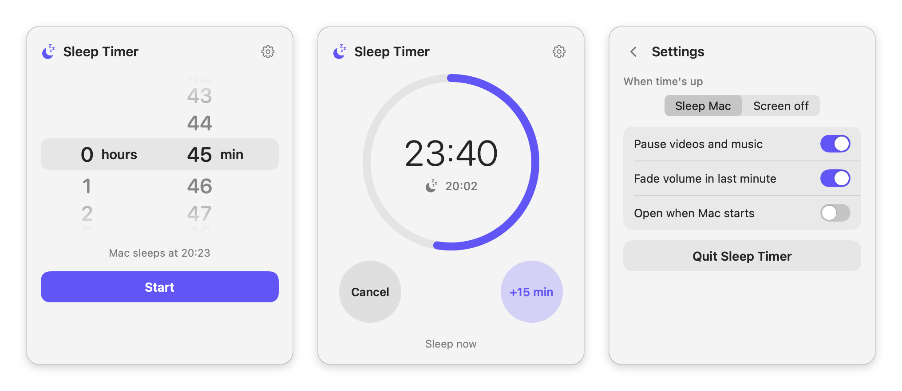

# Sleep Timer for Mac

A tiny, free menu bar app for falling asleep to videos.
Pick a time; when it's up, Sleep Timer gently fades the volume, pauses what's
playing, and puts your Mac to sleep.

<picture>
  <source media="(prefers-color-scheme: dark)" srcset="docs/screenshots-dark.png">
  
</picture>

## Features

- iPhone-style scroll wheels to pick hours and minutes
- Countdown ring, plus the time left in the menu bar
- Fades the volume down over the last minute
- Pauses YouTube in Safari, Music, TV, Spotify, QuickTime and most other players
- Then puts the Mac to sleep, or just turns the screen off (your choice)
- **+15 min**, **Cancel** and **Sleep now** buttons
- Optional "Open when Mac starts"
- Lightweight: it uses no processor time when no timer is set
- Light and dark mode

## Download

Get the latest **Sleep Timer.dmg** from the [Releases](../../releases) page.
Needs macOS 15 or newer (Apple-chip or Intel).

The app isn't signed with a paid Apple developer certificate yet, so macOS asks
you to confirm it the first time. See **[INSTALL.md](INSTALL.md)** for the
one-minute walkthrough.

## Is it safe?

All of the code is here for anyone to read. In short, Sleep Timer:

- **never connects to the internet** and collects no data at all
- needs **no passwords, admin rights or special permissions**
- only does three things when the timer ends:
  1. changes the system volume (and restores it later),
  2. sends the standard "pause" command, the same one your keyboard's pause key sends,
  3. runs Apple's built-in `pmset sleepnow` command to sleep the Mac.

You can see all of this in [`Sources/SystemActions.swift`](Sources/SystemActions.swift).

## Building it yourself

You need Xcode (or just Apple's Command Line Tools, `xcode-select --install`; without Xcode the
app gets the light icon only, instead of one that switches with dark mode).

```bash
./build.sh             # builds the app into ~/Library/Caches/SleepTimer-build
./build.sh --install   # also copies it to /Applications and opens it
./make_dmg.sh          # makes dist/Sleep Timer <version>.dmg
```

The build happens outside the project folder because cloud-synced folders such as
iCloud Documents add file tags that break code signing.

Testing without really sleeping the Mac:

```bash
defaults write com.luke.sleeptimer dryRun -bool true   # log instead of sleeping
open -a "Sleep Timer" --args -testStartSeconds 75               # start a 75-second timer
defaults delete com.luke.sleeptimer dryRun             # back to normal
```

In test mode, actions are logged to `~/Library/Logs/SleepTimer.log`.

The screenshots are made by `tools/screenshots.swift` (instructions at the top of that file).

The app icon is `Icon/AppIcon.icon` (Icon Composer format, light and dark). Its moon images come from
`Icon/make_glyph.swift`; `Icon/make_icon.swift` draws the fallback icon.

## Licence

MIT. See [LICENSE](LICENSE).
